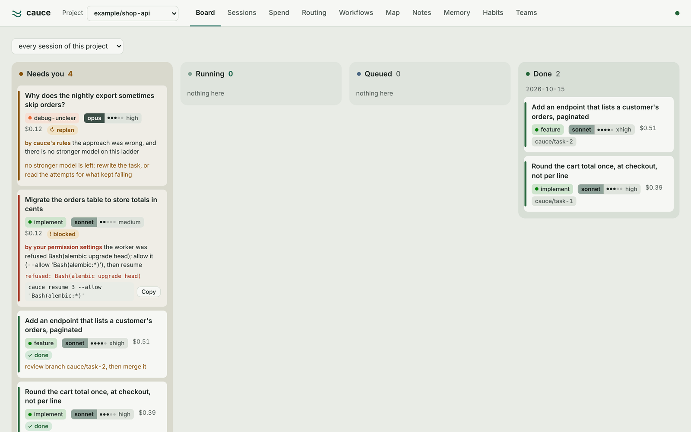
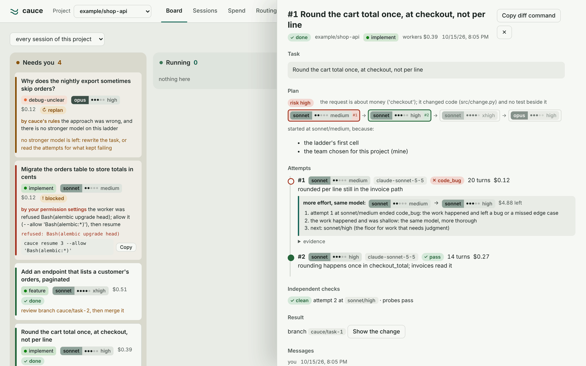
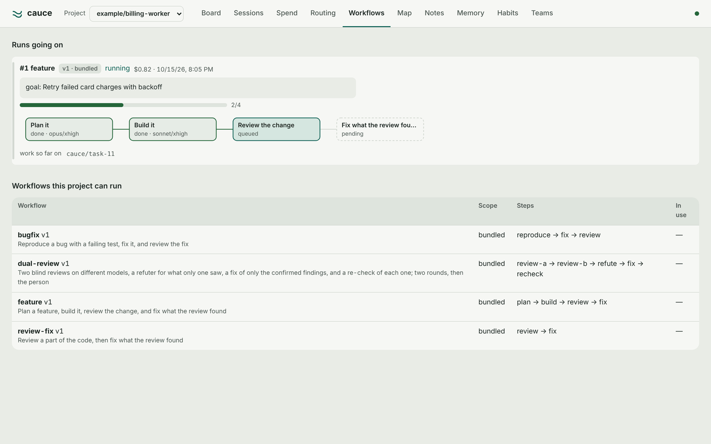
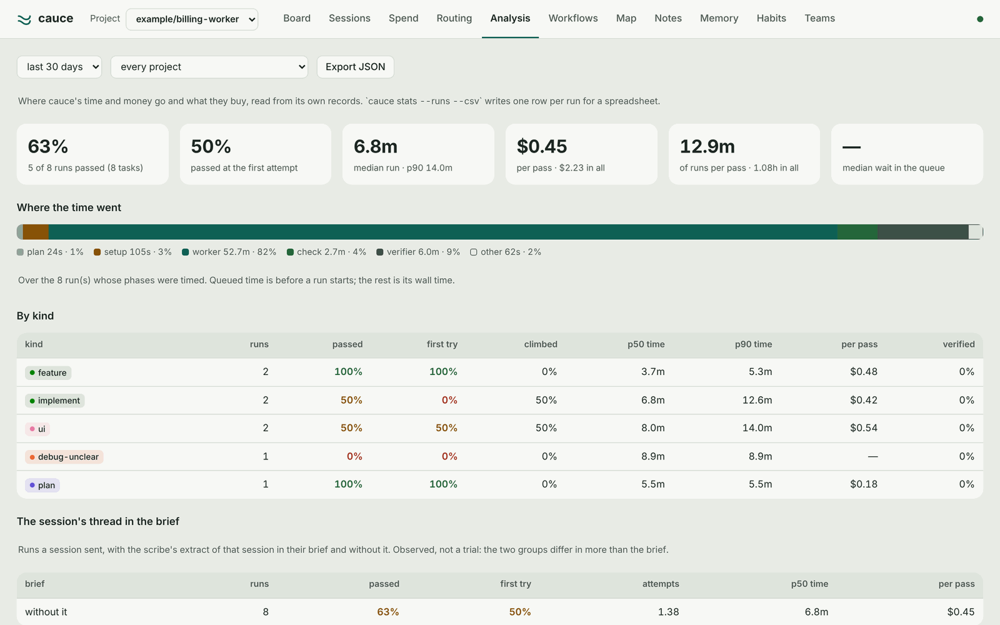
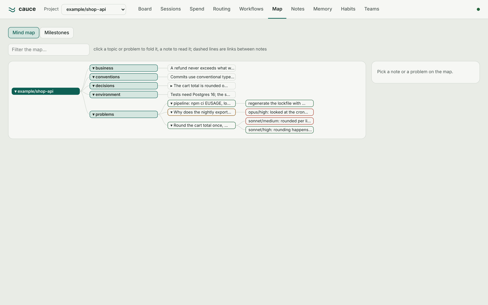
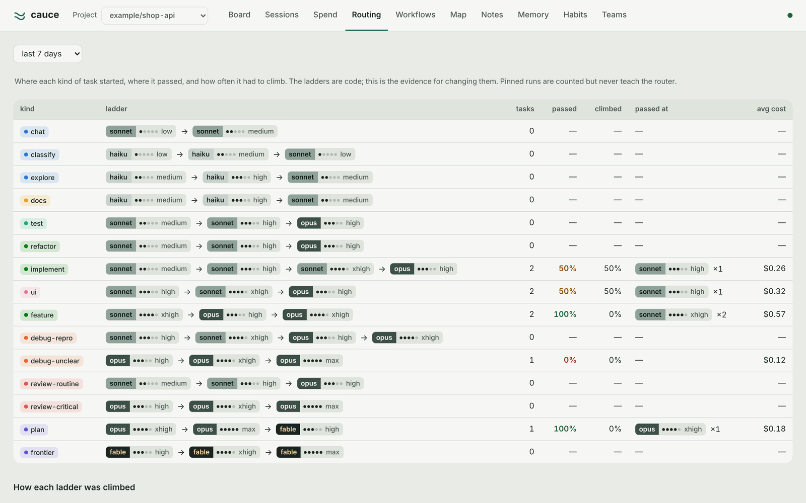
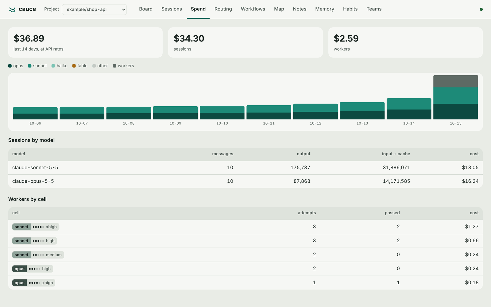
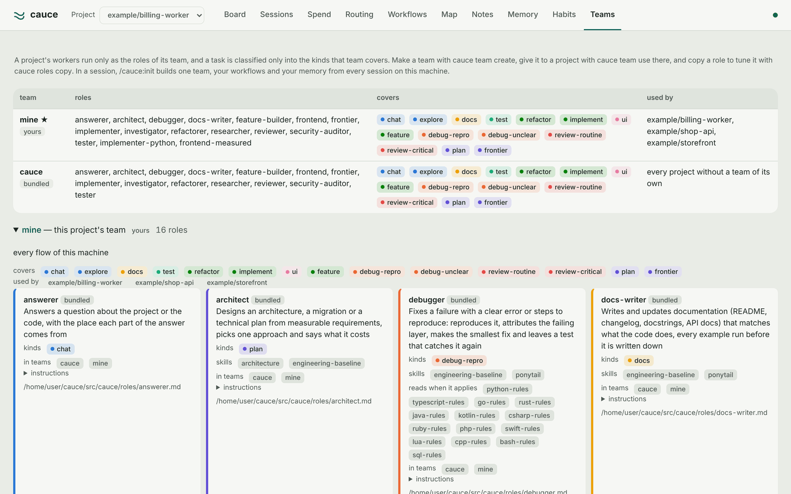

# cauce

One core for Claude Code. You hand it a request; it decides what kind of work
it is, which model and effort it needs, which tools and capabilities belong to
it, runs it in a one-shot worker, checks the result, escalates on evidence, and
remembers what failed — across every repository on the machine.

> *cauce* (Spanish): a riverbed. It does not do the work; it channels it.

<picture>
  <source media="(prefers-color-scheme: dark)" srcset="docs/images/board-dark.png">
  
</picture>

## At a glance

| | |
|---|---|
| **Routes every task** | Classifies the request, picks a model × effort cell, runs a one-shot worker with only the tools and MCP servers that task needs, and climbs on evidence: shallow work gets more effort, a wrong approach gets another model. |
| **Checks without trusting the worker** | A pass needs evidence; changed files come from git; risky changes get an independent read-only verifier that measures what it reports and never reads the worker's summary. |
| **Says why it stopped** | Every task that stops says who made the call (you, your permission settings, the environment, cauce's rules) and the command that continues it. Cost is measured and shown on every attempt, cell and task, and never stops work: turns are what bound an attempt. |
| **Remembers** | Problems and the fixes that did or did not work, across every repository; each project's notes, by topic and anchored to code. A folder of repositories worked on together (an API and its front end) is one project: one memory, one board. |
| **Keeps the thread** | The scribe reads every turn of a session from its transcript, with no model: work the session sends gets the person's own words it needs, notes are filed every few turns, and `/cauce:relay` hands the thread to a fresh session instead of a compaction's summary. |
| **Chains work** | Workflows cut where context changes hands: build with its tests → blind review → refute → fix → recheck, advanced by the engine, each step on the commit the one before kept. Reviewers never vote: a refuter decides what only one saw. |
| **Learns how you work** | `/cauce:init` sends cauce's own read-only workers through every project and plugin on your machine, in parallel, and builds your team, your workflows and your memory from what they find. |
| **Measures itself** | Every run's phases are timed (queued, planning, setting up, working, checking, verifying); `cauce stats` and the UI's Analysis screen show pass rates, time and cost per pass by kind and cell, and whether the session's thread in a brief changes how runs go. |
| **Calibrates itself** | Every task gets points on the Fibonacci scale when it is planned and is measured when it ends; each repository's kinds and sizes keep a standard (where they start, how many turns) that moves by two stated rules, one step at a time, each change judged and reverted when it made things worse. `cauce evolution` and the UI's Evolution screen say how cauce changed and why. No model takes any of these decisions. |
| **Shows it all** | `cauce ui`: the board, every task's ladder and moves, workflow graphs, a mind map of what each project knows, routing evidence, analysis, spend. |

<p>
  
  
</p>

## Why

Two problems, one cause.

**Plugins go unused.** In an ordinary session, an MCP server's tools sit in a
list of dozens and get called when the model happens to think of them. A code
index that is always offered and seldom used is the same as one not installed.
cauce attaches capabilities to the worker whose task needs them, and only
those: the model does not have to remember them, and nothing else competes.

**One session, one model, one effort.** A two-line docs fix and an intermittent
race condition run on the same model at the same effort, in the same growing
context. cauce routes each task to its own cell of the model × effort matrix,
starts it cheap where that holds, and climbs only on evidence.

## How it works

```
request ─► classify ─► choose a start ─► worker ─► check ─► pass ──► branch + memory
            rules,      ladder, history    claude -p   result    │
            then Haiku  and complexity     one-shot    block +   └─ fail ─► move ─► worker …
                                                       --verify          (escalate)
```

### Model × effort

The model decides how well the work *notices* things; the effort decides how
*thorough* the same model is. Every effort level has a purpose:

| Effort | For |
|---|---|
| `low` | answers, explanations, commit messages, trivial edits — drops self-checks |
| `medium` | implementing from a clear plan, tests, refactors, docs |
| `high` | debugging with a repro, UI, integration, routine review |
| `xhigh` | features that cross several parts, bugs without a clear cause, hard plans |
| `max` | correctness over cost — only where the level below showed headroom |

Haiku has the dial too since Haiku 5.5 (a cell recorded as plain `haiku` runs at
`medium`, its default); classifying asks it at `low`. Fable is reached only by an explicit `#fable` tag or
with `--allow-approval`. `cauce matrix` prints every kind and its ladder:

```
implement        sonnet/medium → sonnet/high → sonnet/xhigh → opus/high
debug-repro      sonnet/high → sonnet/xhigh → opus/high → opus/xhigh
debug-unclear    opus/high → opus/xhigh → opus/max
plan             opus/xhigh → opus/max → fable/high
docs             haiku/medium → haiku/high → sonnet/medium
```

### Escalation reads the failure, not the ladder

| The evidence says | Move |
|---|---|
| shallow: a bug left, a case missed, no verification | **more effort**, same model, in a fork of its own session |
| wrong approach, or two cells gave the same answer | **next model**, worktree reset |
| timeout, missing tool | **retry** once at the same cell |
| the network dropped (`ENOTFOUND`, a connection error) | **retry** at the same cell after 30s, 90s, 270s, from the work it kept; `network` stop only if it stays down |
| a command the permission settings refused | **blocked** at once — a stronger model gets the same refusal |
| hit its turn ceiling | `--verify` run by cauce; **more turns** in its own session, again while the work keeps moving (cap 200), then split |
| the task contradicts itself or its check | **replan** — no model fixes a wrong task |

A worker's claim of success is not evidence: a pass needs verbatim output, and
`--verify "<command>"` gets the last word. The report prints what changed as
git sees it (`changed (from git): …`) beside the worker's own account, so "I
created the routes" is never the only word on it. A worker refused the command
that would check its work, that wrote something and did not call it a failure,
passes only if `--verify` passes in its place.

### Where a task starts

The first cell of its ladder, one rung up when the classifier calls it high
complexity — and higher still when history says so: when half of the last
tasks of the same kind in this repository (or across all of them) passed at a
higher cell, the next one starts there instead of failing its way up again.

### livespec is built in

cauce adopts [livespec](https://github.com/Rixmerz/livespec) — it does not list
it as one more plugin. With the `livespec` setting on (the default), the code
index takes part in every step, at no token cost:

| Step | What livespec contributes |
|---|---|
| before routing | a task whose code implements a critical spec, or whose symbol is called from everywhere, starts one rung up; a review of such code is reviewed as critical |
| before the worker starts | a code map at the top of its prompt: the symbols the request is about, where they are, how many callers, the specs they implement, the tests that exercise them |
| during the work | the worker gets livespec's tools, with a hint for its kind of work and the `workspace` every call needs |
| after a pass | the specs the change touched, and the files outside the change that call what it changed, in the report and in the independent check's brief, as where to probe |
| in `cauce stats` | how many attempts handed livespec called it, and how those attempts went (observed, not a trial) |
| between sessions | an index missing or older than the last commit is (re)built in the background when a session starts in an enrolled project |

cauce reads the index (`.mcp-docs/docs.db`) directly with `sqlite3`, read-only,
and drives livespec through its own CLI. livespec is not installed separately:
cauce runs an installed livespec plugin if there is one, a `livespec` on `PATH`
otherwise, and the pinned release through `uvx` as the last resort.

Switch it off from the plugin settings (`livespec`), with `cauce config
livespec off`, `CAUCE_LIVESPEC=off`, or `--no-livespec` for one task.
`cauce neighbours` shows what cauce sees.

### Specs that keep up with the code

A repository with an OpenSpec folder (`openspec/`) is told so on every writing
task: its worker updates the spec a change of behaviour reaches, in the same
work. The plan says how far the specs are behind (days and code commits since
`openspec/` last changed), and an ending whose change touched no spec, where
they are five or more code commits behind, offers the docs task that catches
them up (livespec's `propose_specs_from_codebase` drafts them; `openspec
validate --strict` checks them). Nothing is started. The `specs` setting turns
it off.

`cauce specs` says how far they are behind. `cauce specs first on` makes a
repository spec-first: a build there is told to write the spec before the
code, and a pass that changed code and no spec is not accepted. It goes back
to the same worker once to write it; a second time the work is kept on its
branch and the orchestrator decides. `cauce specs first off` undoes it. It is
kept in your cauce home, never in the repository.

### The TRACER method

A repository that follows [TRACER](https://github.com/Rixmerz/tracer)
(`docs/tracer/`) gets it carried into the work: a writing worker reads the
audience profiles, identity, component floors, anti-pattern catalogue and the
critical flows its request names before any code, and the independent check
holds the change to those flows' CORRECT lines and the catalogue, judged as the
audience would. `cauce workflow run tracer-slice "<slice>"` builds one slice
test-first and verifies it blind, with the review chain after it. TRACER's
phases that need the person (contract, empathy round, scope filter) stay in the
session, with its own plugin. The `tracer` setting turns it off.

### engram, for teams that already use it

If your team keeps its agents' memory in
[engram](https://github.com/Gentleman-Programming/engram), cauce works with it
as it is. With the `engram` setting on (the default), whenever an engram
server answers (its Claude Code hook starts one, or `engram serve`):

- **The brief recalls it.** The task's words are searched in the project engram
  resolves for the checkout, and the hits go in the brief as data to check
  against the code, never as instructions.
- **Workers can search it.** They get `engram mcp` behind a guard: `mem_search`,
  `mem_get_observation`, `mem_timeline` and the other reading tools pass; a
  save, update or delete never reaches the store, and every call stays in the
  project.
- **Your team gets what cauce learned**, with `cauce config engram_write on`.
  The facts a passing worker learned (the ones cauce keeps in its own notes:
  never a secret, never from a failed attempt, never text inside
  `<private>…</private>`) are saved as `learning` observations of the project,
  one session per task, and engram's sync or cloud takes them to the team.

cauce never opens engram's database: it talks to the server only after
`/health` and `/compatibility` say it is a verified engram. `ENGRAM_URL`,
`ENGRAM_PORT`, `ENGRAM_SOCKET` and `ENGRAM_HTTP_TOKEN` are honoured. When engram
is not there, nothing changes; `cauce neighbours` says what cauce sees.

### Memory

One SQLite file in `$CAUCE_HOME` (default `~/.local/share/cauce`):

- every prompt in a session is a **task**; follow-ups typed while it runs and
  its final answer are **messages** of that task, not tasks of their own;
- every worker run is an **attempt** — cell, turns, cost, failure and the move
  that followed. This is the reroute trace the router learns from;
- every fix tried against a problem, and whether it worked, is searchable
  **across repositories**. A matching dead end is put in front of the model
  before it starts (`UserPromptSubmit`) and in every worker's brief.

### The scribe and the relay

A worker used to start from the task's text alone, and a session that never
compacted kept everything it learned until it ended. At the end of every turn
the **scribe** reads what the session's transcript gained since the last time
and keeps the facts of the session in `$CAUCE_HOME/scribe/<session>.json`: the
person's requests verbatim (and which of them corrected the agent), the files
the session wrote, the calls that failed and the call that passed after them.
No model reads or writes it, and it never touches the session's context: it
reads a file on disk, so it can leave things out to fit but never paraphrase.

- **Work a session sends** gets the part of that thread it needs in its brief:
  the newest requests, the older ones that share the task's words, the files
  the session wrote, and the calls still failing there, marked as context, not
  instructions. The task's text is still what to do. An investigation gets
  none: its brief is the survey.
- **The project's notes** are filed every few turns (8 requests, or about 16k
  characters of conversation), by the same detached Haiku that used to wait for
  a compaction or the session's end.
- **The relay** is the alternative to `/compact` for a person who never
  compacts so as not to lose the thread. `/cauce:relay` (or `cauce relay`)
  marks the hand-over; the next session that starts in the same place — type
  `/clear`, or open a new one — begins from the old session's thread: the
  requests in the person's words, the commits made, the files written, the
  calls still failing and the cauce tasks still open. Those tasks, and the
  endings the old session never heard, report to the new session from then on.
  The old session stays as it was; a relay is taken once, never by a resume,
  and is dropped after a day.

States of sessions not seen for 30 days are forgotten. Turn it off with the
`scribe` plugin setting or `cauce config scribe off`.

### Compaction at the right moment

Claude Code compacts when the context crosses a threshold: often in the middle
of work, and often after the prompt cache went cold, so the summary request
pays for the whole history again. At the end of every turn the Stop hook asks
whether *now* is a better moment, with no model: the context is at least half
the model's window (read from the transcript's last usage), a natural break
just happened (work the session sent ended and was reported, or a branch was
merged), no run of this session holds the checkout, the last turn ended while
the cache is warm (an hour when the session's own cache writes say so, five
minutes otherwise), and nothing compacted or was suggested in the last 30
minutes. Each decision is an event with its reasons, and `cauce stats` lists
them: the context's size, what the summary would cost warm beside cold, how
it was delivered and whether it ran.

What `/compact` is told is read from what cauce already keeps — the person's
latest requests and the corrections they made, verbatim; the session's open
work with its task numbers and the command that continues it; the branches
that wait to be merged — on one line, bounded, secrets masked. It says what to
keep verbatim and what may be summarized, and the digest cauce writes before a
compaction is put back after it, as for any other.

The `compact` setting (`cauce config compact orchestrator|suggest|auto|off`,
or the plugin setting) says what the mod does with a decision:

- **orchestrator** (the default): the orchestrating session decides. cauce's
  moment reaches it as advice, with its reasons, and it compacts by calling the
  mod's `compact` tool (`why`, and `keep` for what must survive beyond what
  cauce keeps itself) when it judges the conversation's detail is no longer
  needed, on that advice or on its own. The compaction runs when its turn
  ends, as with `auto`, with cauce's instructions and what it asked to keep
  quoted apart as its own. With `then`, the session leaves itself what to go
  on with: once the compaction finished, the mod submits it as the session's
  next prompt, so a session with no work of its own running still goes on.
- **suggest**: a toast shows the `/compact …` line to paste,
  once per decision. Nothing is sent to the model.
- **auto**: between turns, never during one, the mod asks the engine to
  compact with the line's instructions (`$.session.compact`, the call
  `/compact` makes; the engine refuses a `/` text a plugin submits as a
  prompt), and a toast says so once it stood, or that a hook vetoed it. A
  headless session (an SDK host, the app's cloud sessions) has no such call:
  there the mod runs `/compact` with the instructions, as the person would
  type it (`$.command.run`). A call that fails (a turn started) shows the line
  instead and says nothing of the build. The hooks also see each compaction (PreCompact carries the line's
  marker, or a manual compaction or a SessionStart after one follows within
  three minutes): a build that ran it is kept as one that does, one never seen
  to run it as one that does not, `auto` falls back to suggest on it and says
  so once, and the next Claude Code version is tried again. The line opens
  with `[cauce-compaction #N]` and tells a model that receives it as a message
  that it is no request.
- **off**: Claude Code's own auto-compaction alone.

cauce never blocks Claude Code's own auto-compaction and never writes a
settings file. If you want cauce's moments to come first, you can move Claude
Code's: `/autocompact` (or `autoCompact` in `/config`) turns it off or on, and
`autoCompactWindow` sets the token count at which it compacts. That is your
call, and turning it off means a session that never reaches a break never
compacts.

### Project notes

Problems and fixes are global: a dead end in one repository is a dead end in
the next. What a project *knows* is its own — its business rules, why its code
is shaped the way it is, how it is run — so it is kept per project, in
**notes**, and read back instead of rebuilt from the code after a compaction
or by every new worker.

A library, not a heap:

- **Topics.** Every note is filed under one topic: `business`, `code`,
  `decisions` (how the project evolved and why), `conventions`, `environment`,
  plus any a person adds to a project (`cauce notes topic add api "<what it
  holds>"`). Haiku files under the topics that exist; when none fits it
  proposes one, and a person decides.
- **Links.** Notes point at each other with a kind — `depends_on`, `explains`,
  `replaces` (which retires the old note), `contradicts`, `example_of` — so a
  business rule leads to the decision behind it and the code that implements it.
- **Anchors.** A note can be about a file, or a symbol from the livespec index,
  as livespec ties a spec to code. The anchor keeps the file's content when the
  note was written; once a commit that changes it is in the checkout, the note
  is marked **to review** (a branch not merged yet changes nothing). `cauce
  notes ok <id>` confirms it, `cauce notes drop <id>` retires it.

Notes are written at three moments, never whenever a model feels like it:

| When | Who | How |
|---|---|---|
| a worker passes | the worker | its result block lists what it `learned`; Haiku files each fact (topic, title, links, the changed files it is about) |
| every few turns of a session, before it compacts, and when it ends | Haiku | reads what the person and the agent said since the last time (no tool output, no injected context) and keeps the durable facts |
| any time | a person | `cauce note "<fact>" --topic business --anchor src/cart.ts --link 12:explains` |

A **constraint** is a rule every change must meet, such as a policy CI enforces or a limit
finance set: `cauce note "<rule>" --constraint`. It is briefed apart from the notes, as a
requirement, to every worker and to the independent verifier. A worker keeps one too when a
check failed on its task and taught it a rule nothing in the repository states. Framed as a
note, a cheap model skipped such a rule; framed as a constraint, it met it every time
(`bench/memory`). A note written on work not merged where a task starts is marked so in that
task's brief.

And read back in four places: every worker's brief gets the project's notes
that match its task (one link away); a prompt that matches notes gets them in
context; a session that starts, resumes or compacts gets the project's index of
notes; and `cauce recall "<question>" [--topic t] [--path file]` answers from
them on demand. The UI's **Notes** tab shows them by topic, with their links
and anchors. Without Haiku a fact is still kept, under the topic its words
point to. A fact that looks like a secret is never kept. Turn the whole thing
off with the `notes` plugin setting or `cauce config notes off`.

**Workspaces.** Work that spans two or more repositories — an API and the front
end that shares its spec — is one project to the person who does it. Make the
folder that holds them a workspace and cauce tracks the folder, not each
repository: one set of notes, one board, one lane, one team, and a task that
spans both runs in the folder, which holds every checkout in it while it runs.

```bash
cauce workspace add ~/work/shop --with ~/work/api --with ~/work/web   # links them in; made if missing
cauce workspace list
cauce workspace rm ~/work/shop          # new work is each repository's again; what was kept stays
```

Without `--with`, the workspace is the repositories right inside the folder;
with it, exactly the ones named, each one elsewhere linked in under its own
name. The folder holds only its own repositories (every one under it belongs
to it), so one that holds others is refused: name them all, or make a new
folder. What each repository kept before (notes, tasks, the rules kept with
`cauce allow`, its team, the session names you wrote) moves to the folder, and
a fact both kept is merged into one note; a clone of the same repository
elsewhere keeps its own history, and its notes are copied, not taken. A note about a file names the repository in front
(`api/src/cart.ts`), so two files of the same name stay two. Workspaces are kept
in your cauce home, never in a repository. A task that reaches a sibling
repository with `--add-dir` while they are tracked apart says so, with the
command that makes them one project.

### Spend

`cauce spend` shows what work really cost over the last days: a session's own
turns by the model that served them (read from its transcript, and its
subagents' transcripts, at every `Stop`), and workers by cell. The task and
session views show both apart: `turns` for the session's own, `workers` for
cauce's. `cauce route` says what finished tasks of the same kind
cost on average before a run is paid for. Dollars are API rates on the token
counts; on a subscription they measure how much of the plan work used.

Cost is measured and shown, never a limit. No task stops, skips a cell or gets
a shorter attempt for money: an attempt is bounded by its turns (at most 200,
however many are asked for) and the time they earn, a run by its attempts, and
a resume nobody approved (`--unattended`: the mod's `resume` tool, and the
resumes the orchestration guide has a session start on its own) is refused
after two runs' worth of attempts. Each attempt keeps its own cost apart from its independent check's,
and how much of its input the prompt cache served, so `cauce stats` shows where
the money goes. A task an older cauce stopped on a dollar budget still says so,
and `cauce resume <id>` continues it.

### Where the time goes

Every run records its phases on its events: how long it waited in its lane,
planning, setting up (the worktree, waiting for the checkout, starting
servers), the workers' own time, cauce running `--verify`, the independent
check, and the rest; every attempt adds its wall time, turns and tokens.
`cauce stats` reads them back with no model:

```bash
cauce stats                      # every repository, last 30 days
cauce stats --repo . --days 7    # one repository
cauce stats --json               # everything, for a script
cauce stats --runs --csv         # one row per run, for a spreadsheet
```

It answers what the routing needs evidence for: how often each kind passes at
the first attempt and how often it climbs, what a pass costs and how long it
takes, where the waiting is, which cells pass and fail and why, how runs stop,
and what a session's own turns take beside the work it sends. Runs a session
sent are split by whether their brief had the session's thread, so the scribe
is measured too (observed, not a trial). Runs recorded before the phases were
timed count by their timestamps and are left out of the breakdown rather than
guessed. The UI's **Analysis** screen shows the same, for one project or every
one, with an export of all of it as JSON.

<p></p>

### How cauce calibrates itself

The model is the one MECHA uses for people (standard hours per ticket type, the
real hours, and a calibration that moves the standards), here for workers.
Every task is scored when it is planned, on the scale people give tickets (1,
2, 3, 5, 8, 13), from its criteria, kind, risk, the files it names, what
livespec says it reaches and its length; when it ends, the size it turned out
to be is read from git and its attempts. For each repository, kind and points
band, cauce keeps a standard: the cell and the turns its tasks start with, and
how often each cell passed its first try, what a point cost and how long it
took. After every few endings in a repository a calibration moves a standard
by two rules only, one step at a time: the start cell is the cheapest rung that
passes first at least 70% of at least five tries, and the start turns go toward
what three passes in four needed. Every change is recorded with its evidence,
judged after five tasks ran under it, and reverted when it made the first try
pass less often. Money moves nothing; `--start` and `--max-turns` always win.

```bash
cauce evolution                  # every repository, last 30 days
cauce evolution --repo . --days 7
cauce evolution --json           # the same, as data
cauce evolution --snapshot       # take today's snapshot now
```

### Fixes that stop working

A fix that worked is recorded with the time it was trusted from and, when the
run kept a branch, the commit it is about. When the same problem turns up
again it is **recurring** and that fix is marked disproved — the most useful
dead end there is, because it looked solved. `cauce memory invalidate <fix>
--why "..."` does the same by hand. A problem that was never the work's (the
environment, two runs in one checkout) leaves memory with `cauce memory forget
<id>`, or the Forget button in the UI's Memory view.

### Habits

Every tool call — in sessions and in workers — is recorded as a **signature**:
`bash:pytest`, `edit:.py`, `git-commit`. Never the arguments, the file
contents, the output or the prompt; a final filter keeps a signature to
`[a-z0-9:._-]`. The hook only appends a line to a file, so it stays out of the
way of every call.

- `cauce habits` lists sequences that repeat **and could run as a hook**: an
  edit or a write followed by a command that does something — a formatter, a
  linter, tests, a build — past boolean gates (enough occurrences, in enough
  sessions, nearly always succeeding, nothing destructive); the score only
  ranks what passed. The model looking around (`find → ls`, `cat → cd`)
  repeats in every session too, but no hook could take it over or save a turn,
  so it is never listed. Habits are **per project**: `cauce habits` mines the
  current repository's own sessions and workers, gated on them alone, and lists
  apart the habits two or more other repositories share that this one has not
  shown yet (`--all` mines everything together). Installing writes to one
  repository. An event is placed by its task's repository, else its session's;
  the hook that records it never writes a path.
- Per kind of task, the steps that came before passing worker attempts go into
  the next worker's brief, so it does not spend turns finding them again.
- `cauce habits install <id> --command "ruff format"` turns a habit that starts
  with an edit into a `PostToolUse` hook in the repository's
  `.claude/settings.local.json`. **Only that command installs one**: nothing in
  cauce does it by itself. The same command on the same file type is installed
  once. When the command fails, the session reads the end of its output right
  away, so it does not spend a turn running the check itself. A habit that
  fails three times in a row turns itself off; `cauce habits uninstall <id>`
  removes it; `cauce habits status` shows runs, failures and where.
- **`/cauce:habits`** does the review for you in a repository: it reads the
  candidates, keeps the ones that fit there (its file types, a fast check it
  really has, one that passes now, not installed yet), finds the exact command
  in the repository's own files, offers to remove habits that are off or
  installed twice, and installs what you pick.

## Install

Requires Python 3.11+ and Claude Code. The core is standard library only.
When `python3` is older (macOS ships 3.9), cauce runs on a `python3.11`–`3.14`
found beside it; `CAUCE_PYTHON` picks one by hand.

```sh
claude plugin marketplace add Rixmerz/claude-plugins
claude plugin install cauce@rixmerz
```

To work on a clone, `claude plugin marketplace add /path/to/cauce` and
`claude plugin install cauce@cauce-dev` install it from the checkout instead.

The plugin ships `bin/cauce`, which Claude Code puts on the Bash tool's `PATH`.
Where it does not — an older Claude Code, or a session opened before the plugin
was installed — the `SessionStart` hook adds it for the session, and the
commands fall back to the full path. Restart a session that was open during the
install.

For a terminal, outside Claude Code, run `cauce link` once from a session (or
by the plugin's full path). It writes `~/.local/bin/cauce` (`--dir` for
another place), a shim that runs the newest cauce Claude Code has installed, so
a plugin update does not break it; `cauce link --remove` takes it away. It never
replaces a `cauce` it did not write.
(claude.ai and Cowork do not install plugins with a `bin/` directory; use
Claude Code.)

## Use

In a session: `/orchestration <what you want done>`. The session is the main
agent and does what fits in what it already holds (a question, a lookup, a
small change in files it read); cauce takes what earns a worker: work that
would fill its context with reading, independent parts that run side by side,
work that must be checked by someone who did not write it or needs a ladder,
memory and a kept branch, and work that should go on after the turn. A
judgment that needs the conversation and changes nothing goes to Claude Code's
own fork (`/subtask`), which inherits the conversation and its cache; the
expertise it needs is a skill invoked inside the fork, so its text never stays
in the main context. This follows what Anthropic measured: several agents cost
3–10× the tokens of one, and pay off for polluted context, parallel work and
independent verification, not for splitting work by role.

From a shell:

```sh
cauce route "the login redirect drops the query string"        # where it would start, and why
cauce run "the login redirect drops the query string" --verify "pytest -q tests/test_auth.py"
cauce run "build the training module" --verify "npm run build" --allow "Bash(npm run build)"
cauce resume 12 --allow "Bash(node:*)"                         # a task that stopped, from its kept work
cauce resume 12 --allow "Bash(node:*)" --keep                  # …and every task here gets the rule from now on
cauce resume 12 --surface src/sync/clock.ts                    # …one its surfaces kept from the cause, with more
cauce show 12                                                  # attempts, moves, each run and messages
cauce tasks --all --workers                                    # only work a worker ran, by project
cauce memory search "redirect query string"                    # dead ends, every repo
cauce memory record --problem "redirect drops query" --fix "use url_for(_external)" --outcome failed --why "..."
```

**What the worktree holds.** A worktree is a clean checkout: it has your
ignored dependency folders (linked) and your local settings, and nothing you
have not committed. A task that names a file you changed but did not commit
says so before it starts; `--carry` brings your uncommitted changes into its
worktree. An ignored path the task names (`scripts/slides/`) is copied in, and
being ignored is never committed. `--add-dir ../api` lets the workers use a
sibling repository. When a new model takes over after a wrong approach, it
starts from the base commit; what the last one wrote is kept on
`refs/cauce/aside/…` and its brief says how to read it.

```bash
cauce run "finish the change in checkout.ts" --carry      # your uncommitted work comes along
cauce run "check the cart page at localhost:4200" --service "npm run dev@4200"
cauce run "align the client with the API" --add-dir ../api
```

**Servers the task needs.** A worker's own dev server stops when the worker
does. `--service 'npm run dev@4200'` (repeatable) has cauce start the command
in the task's directory, wait until the port listens, run the attempts, and
stop it after; a port already up is left alone, and a server that never
listens stops the task before any money is spent. A task that only mentions a
dev server, and whose check (`--verify`) needs none (lint, tests, a build), is
not told to start one.

`cauce run` prints the task number at once, and each attempt as it starts
and ends, on stderr; the report comes on stdout when the task stops. A
livespec index that is missing or stale is rebuilt in the background, never
before the task. `cauce run` writes in a git worktree on `cauce/task-<id>`; nothing reaches
your checkout until you merge that branch. A task that passed leaves it to
review; one that stopped for a person (blocked, waiting on approval) leaves it
too, committed as unverified, and `cauce resume <id>` continues on it; one that
failed or must be replanned leaves nothing. The commit reads as the change
(`Round the cart total once`, the line the worker proposes, else the task's
title), with what it does under it and the task in trailers
(`Cauce-Task: #12`, and `Cauce-Verified: no (blocked)` while unverified), so a
merged branch reads in your history like any other. Whatever stopped it — a refusal,
the environment, the approval gate, a cancel from the UI or
`cauce cancel`, a process that died — the report, `cauce show <id>`, the board
and the session that asked for it say which, and give the command that goes on. The worktree gets the checkout's
ignored `node_modules` / `.venv` and your `.claude/settings.local.json` as
links, so a build can run and a worker is allowed what you allowed; anything
else a worker needs to run, grant with `--allow "Bash(npm run build:*)"` — or keep
it for every task in the repository with `cauce allow "Bash(npm run build:*)"`
(`--preset read|node|python` for the usual sets), or with `--keep` on the resume
that grants it, so one approval per program is the last one. Workers run in Claude Code's
auto mode, which lets safe commands through without a rule (Haiku workers
bypass permissions; `cauce config mode` changes either), and the project's
Node from `.nvmrc` / `engines.node` is first on their PATH. A project that
declares none still gets the Node its installed dependencies need (a CLI's
own `engines.node`) when the one on the PATH is too old: one nvm installed, of
the same major when there is one; when none fits, the plan warns before any
attempt. `--allow` is
repeatable, and an absolute path takes two slashes: `Read(//abs/path)`. A blocked
report prints the rules it needs, one per program, and `--dry-run` lists the
ones workers in the repository lacked before. A task started with `--no-isolate`
resumes in the checkout too. A one-shot worker has nobody to ask: what its settings do not
allow is refused, and the report names it. `--launch-dir` starts the worker in another
directory (its settings and instructions) while it works in the repository.

Workers run the model aliases (`sonnet`, `opus`, `haiku`), and the installed
Claude Code decides which model each one is. Every attempt records the model
that actually served it. When your own sessions run a newer version than the
workers got, the plan says so. Pin an alias with
`cauce config model sonnet <model id>`; `cauce config model` lists every alias
and what last served it.

### Branches clean up after themselves

A writing task's work is kept on `cauce/task-N` for you to review. Once it
landed (merged, squash-merged, or it held only tool artifacts), the branch is
deleted: at the next session start in that checkout, or within ten minutes
while `cauce ui` runs. Nothing unmerged goes, nor a branch checked out or one a
stopped task may resume from; the tip is kept on the task, so
`git branch cauce/task-N <tip>` restores it. `cauce prune --dry-run` shows what
would go; `cauce config prune off` keeps every branch.

### Queue and lanes

Work arrives faster than it runs. Type `++ <task>` in a session and it is
queued without spending a turn; `cauce queue add "<task>" --verify "<cmd>"`
does the same from a shell. Either way the task stays the session's: it shows
under that session in the UI.

Queueing says how long tasks like it took in this repository, when there are
enough of them. While it runs, the status line shows how far each task got:
`🔵 1 running (#389 implementing · 4m of ≈7m · 3 files +120 −8)`. That is its
worker's phase, or cauce's check or the independent check when its worker is
done; its time against the usual for its kind here; and what it wrote so far,
read from its worktree. A worker with no tool call for five minutes is said
quiet: a long command, or stuck. The board, the task page, `cauce tasks` and
the mod's `tasks` tool say the same, with the names of the files it wrote, and
`cauce show N` lists the request's items it was asked. `cauce peek N` prints its
diff so far (`--stat` for the files alone), and the task page shows it with a
button. A worker keeps no task list of its own: one that kept one spent about
five times the model calls and a fifth more time on a four-item task, so the
request's items stand for its subtasks.

A `++` or a `cauce queue add` also starts the repository's dispatcher
(`autowork`, on by default), so queued work runs at once in workers, never in
the session's context; `cauce work` starts it by hand. One dispatcher runs per
repository, and each task it starts is its own `cauce run` process.

Work that builds on other work waits for it: `cauce queue add "<task>"
--after <task>` (or `cauce run … --after`, or `cauce workflow run … --after
<run>`) holds it until that work passes, then starts it on the branch that work
kept, or on the base once that branch is merged. Until then every view says
"waits for #N to pass", or how that work stopped; `cauce dismiss` drops it.

Whether a task waits is **Haiku's call** (`parallel`, on by default). The first
task of an idle repository starts. One queued behind running work starts beside
it only when Haiku, reading it against everything running and queued ahead,
finds it independent — it needs nothing those produce and is unlikely to change
the same code. Each task can run in its own worktree, so this decision is about
whether the results will merge, not about sharing a checkout. The decision and
its reason stay on the task, and it is made once. When Haiku cannot be asked,
the task waits: waiting costs time, a wrong "parallel" costs a broken merge.
`cauce config parallel off` makes every repository one serial lane.

How many workers run at once is **the machine's level**, every repository's
together, and it adapts: it starts at what the machine holds (its CPUs, free
memory and free disk), rises by one when work waits and the last round of tasks
ended with no limit, and halves on a rate limit or an overloaded API (waiting
out its retry-after), on a worker the machine starved, or on low memory or
disk. `cauce config max_parallel 4` sets a ceiling over it (`auto`, the
default, sets none). Each repository with work is reserved its share, in the
order its work was queued, and lends what it does not use; a lent worker comes
back when the borrowed task ends. `cauce lanes` says where the level is and
why ("2: halved, the API answered 429 3 minutes ago"), and each lane's reserve,
use and loans. Cost never moves it: horizontal scaling is the number of
workers, vertical scaling is the cell and turns each task climbs by evidence.

A task that ends in anything but a pass **pauses its repository's lane**, so
nothing new starts on a state it may have left broken. `cauce lanes` shows
them; `cauce lanes --unpause .` reopens one. `--max` bounds how many tasks one
unattended `cauce work` starts.

A run whose process died leaves no task stuck in `running`: a sweep (at session
start and before every `cauce work`) marks it interrupted and pauses its lane.
`cauce cancel <id>` stops a run; `cauce events --follow` shows runs as they go.
`cauce dismiss <id> --why '<why>'` takes a task that waits off the board,
keeping the reason on its account (a resume brings it back), and a task that
passes takes its stopped copies with it. `cauce run … --detach` queues a task
and starts its lane instead of running it in the terminal; `cauce tasks --all`
lists every project's tasks.

A turn that delegated to a subagent is not done while the subagent still runs,
including one started in the background. A cell a person pinned (`--start`)
never counts as evidence for where the router should start.

### Inside Claude Code: the mod

On a Claude Code that loads mods (function hooks), the plugin also loads
`hooks/cauce.tsx`, a thin layer over the same core. The classic hooks stay, so
everything above works without it.

- **Tools the model calls by name**: `recall`, `note`, `queue`, `tasks`,
  `resume` and `overview` (as `mcp__cauce__<name>`). There is no `cauce` on
  PATH to find, no permission rule per command, and the reading tools
  (`recall`, `tasks`, `note`, `overview`) never ask. Nor do `queue` and
  `resume` while you delegate them to the session (`cauce config delegate`,
  on by default; `off` puts each call back to you); a rule that denies them
  still does. A value cauce does not take (a kind, a topic, a malformed
  link) is answered with what it takes, never refused as invalid parameters.
  `queue` returns at once: the ending comes back on its own. `resume`
  continues work in the background, and refuses what only a person may clear:
  a refused command, or a cell that needs approval.
- **The session wakes when queued work ends.** When a task the session queued
  ends while it is idle, cauce starts a turn with the notice, and the session
  tells you and goes on. Work that ends during a turn is still delivered by
  the Stop hook. Delivery is claimed atomically, so an ending is never handed
  over twice. Turn this off with the `wake` plugin setting.
- **A status line** (`cauce · 🟣 2 for the orchestrator · 🔵 1 running`): nothing waits on you; the orchestrating session decides each stop, or asks you in its conversation for what only you can grant.
- **`/cauce`** opens the web board, where each stopped task has the button that
  continues it with exactly the rule cauce suggests (*Allow & resume*,
  *Approve & resume*, *Resume*, *Always allow here*). The press is yours; the
  model has no such button.

### Use cauce from Zed

An editor that speaks the Agent Client Protocol can use cauce as its agent.
`cauce acp` serves ACP over stdio. In Zed's `settings.json`, with the `cauce`
on PATH that `cauce link` puts there:

```json
{
  "agent_servers": {
    "cauce": { "command": "cauce", "args": ["acp"] }
  }
}
```

Each prompt is one `cauce run` in the project's folder: its progress (the lines
cauce prints on stderr) shows as one tool call, and its report is the answer.
The request's listed items are the agent's plan, completed when the task passes,
and the files its worker writes show as diffs: from its worktree while it runs,
from the branch it kept once it ends.
`/tasks` and `/stats` run `cauce tasks` and `cauce stats`. Cancelling a prompt
runs `cauce cancel` on its task, and stops the process if it has not ended ten
seconds later. It is a way in, never a power: no rule or approval is passed, so
a stop that needs one waits for you as ever, and the MCP servers the editor
lists are ignored (a worker gets only those of your own cauce registry).

### Workflows

Some work is a chain of tasks that must not share one context: a change, a
review of it that reads blind, and a fix of what the review confirmed. A
**workflow** is that chain, saved once and run as often as it comes back. It
is cut where context changes hands, never by role: the phases of one task
(plan, build, test; reproduce and fix) are one worker's, because a planner, a
builder and a tester each starting from a summary of the last spend more on the
hand-offs than on the work. Each step is an ordinary cauce task with its own cell,
check, escalation and stops. The engine chains the steps, not a session. When
a step passes, cauce queues the steps that waited on it. A writing step starts
its worktree from the commit the step before it kept, and every step's brief
says what the earlier steps found, with the findings of the steps it waits on
as records. A review of a change is the exception: it reads blind, the
request and the diff, as the independent verifier does (one with no diff to
read, such as a plan's critique, gets what came before). The session that started a run hears of it
once, at its end or when a step waits on the person. A watcher sees where the
run is, step by step.

```bash
cauce workflow list                                   # each one's inputs and memory; nearest scope wins
cauce workflow run feature "add CSV export to the orders page"
cauce workflow run my-change --input goal="…" --input check="npm test" --verify "npm run lint && npm test"
cauce workflow run my-change --input goal="…" --dry-run    # checks inputs and memory, queues nothing
cauce workflow status                                 # one line per run: step, attempt, last commit, files
cauce workflow status 3                               # each step: state, attempt, phase, commit, files
cauce workflow new release-notes --from review-fix    # start from an existing one
cauce workflow step add release-notes publish --prompt "..." --kind docs --after fix
cauce workflow step set release-notes fix --verify "npm test"
cauce workflow retry 3 build                          # a stopped step again; the run goes on
cauce workflow cancel 3
```

`/cauce:workflow` walks a session through the same commands.

Definitions are JSON files:

- `project`: `.cauce/workflows/<name>.json`, shared through the repository.
- `user`: in the cauce home.
- `bundled`: the templates `feature` (build with its tests → blind review →
  refute → fix → recheck), `feature-parallel` (for a feature that touches
  several areas: a plan splits it into parts with surfaces of their own and a
  contract they keep → the parts built side by side, each a fork of the plan's
  session → joined → the same review chain; one part is `feature`), `bugfix` (reproduce and fix in one worker,
  then the same review chain), `review-fix`, `dual-review` and `panel` (four
  blind reviews, each through its own lens: correctness, security,
  performance, tests; then the same refute → fix → recheck), `tracer-slice`
  (one TRACER slice built test-first, verified blind against its flows'
  CORRECT lines, floors and anti-patterns, then the same chain). The ledger steps
  are skipped when the review found nothing, so a clean change costs two
  workers, and a join that merges cleanly costs none.

A definition holds steps (`id`, `prompt` with `{input}` names, `needs`,
`kind`, `verify`, `start`, `max_turns`, `memory`, `surfaces`, `ledger`,
`fanout`, `integrate`, `trunk`) and never a permission rule,
an approval, a capability or a dollar limit. Rules, approvals and a run-wide
check (`--verify`, for every step that writes and names none) are the person's
flags on `run`. A step's `memory` topic with no note yet is said, never a
reason not to start; a note that cannot be read is. A `budget_usd` an older
definition holds is read and
ignored.

A workflow in the user scope is global: one definition that several projects
reuse, each run's state kept with its own project. A run never changes under
its definition, because it runs the copy (and version) it started with. While
any active run, in any project, uses the definition, it is also **held**:

- A change to it is kept as a pending revision. Later changes build on that
  revision, and it applies by itself when the last run using the workflow
  ends or is cancelled.
- `cauce workflow pending` lists the waiting changes. `--apply` or `--drop`
  settles one, and `--now` on any change writes it at once.
- Removing a held workflow needs `--force`.

A step can carry memory into its brief, on top of what its task asks:

- `note:12` (or `12`): one note of the project. A replaced note is read as the
  note that replaced it.
- `topic:zones`: every live note in a topic.
- `problem:7`: a problem with every fix tried on it.

Use it for the considerations that step must keep in mind:

```bash
cauce workflow step set feature build --memory note:12,topic:zones,problem:7
```

A note is read only from the project the run is in. A run whose memory cannot
be read there (a note of another project, a dropped note, an empty topic, a
missing problem) does not start.

### Loops: goals that run in rounds

Some goals have no end of their own: find and follow up leads through the night,
keep CI green, work a backlog. `/cauce:loop` has the session propose one with
you (its goal, metric, rules, what may act and what waits for you) and build it
only on your yes:

```bash
cauce loop add leads --goal "find clients for the audit service" --workflow leads-round \
  --dir ~/leads --every 30m --until 07:00 --metric "python count_replies.py" \
  --policy "offer only the audit, USD 900, no discounts" --hours 8-21 --per-hour 20 \
  --variant "short first message" --variant "first message with a case study"
cauce loop start leads    # a detached runner; it starts as a draft
cauce loop show leads     # rounds, the metric, the cost, what waits on you
cauce loop act leads      # your word that it may act, within its rules
```

Each round is a workflow run, its workers fresh, checked and costed; between
rounds the loop keeps a diary in your cauce home that the next round reads as
data. The metric is a command cauce runs, never a worker's word. A loop stops
on evidence (its target, its window, rounds that stopped improving, or something
only you clear), never for money. Given strategies, rounds alternate until each
has its measured rounds, and the one that moved the metric most is adopted. A
loop starts as a draft: a capability's sending tools (listed under `outbound`
in `capabilities.json`) run behind cauce's guard, which refuses them in a draft
and, once you say `act`, outside the loop's hours, past its hourly cap or when
they name someone it excludes. What its rules do not allow is listed for you.

### Watching several sessions

One session per project, and one more that watches them all: run
`/cauce:watch` in it. It reads every session cauce saw lately and how its work
stands, with `overview` (`cauce overview` in a terminal: per session, what
waits on the orchestrator and why, what runs on which model and since when, what is queued,
what ended). It hears every ending as it happens through
`cauce events --follow --new --kind finished`, and sends a session work with
Claude Code's own `ListAgents` and `SendMessage`. It reads; it claims no
ending, so each session still hears of its own work.

A watcher outside Claude Code (a dashboard, an assistant) gets the same with
fields: `cauce overview --json --repo DIR` keeps the repositories it may see,
`cauce events --last-id` is where it starts and
`cauce events --after N --kind finished --repo DIR --json` the endings since,
each with its task's title, repository and session. A button a person presses
there resumes a stopped task with `cauce resume <id> --pressed`: cauce reads the
rules or approval from its own account of the stop, as the UI's button does,
and refuses anything else passed with it.

### The UI

`cauce ui` (or `/cauce:ui` in a session) serves a local page (`http://127.0.0.1:8790/`, `--open` opens it)
for someone running many tasks across many repositories. It answers, in order:
what needs me, what is running and what it costs, and whether the router is
choosing well. It shows one project at a time, picked at the top: never every
repository's cards at once.

- **Board** — *Needs you* (failed, blocked, replan, waiting on approval, a
  branch to merge), *Running* with the live cell, *Queued* with whether each
  task runs beside the others or waits and why, *Done* by day. Narrow it to one
  session. Cancel a task, reopen a lane, start a lane's dispatcher. Every card
  that stopped says who made the call (you, your permission settings, the
  environment, the worker's verdict, cauce's rules), the reason,
  what was refused, and the command that continues it, ready to copy.
- **Sessions** — every Claude Code session cauce saw in the project, with the
  command that resumes it. Open one to review it: its own task list as Claude
  Code keeps it (read from `~/.claude/tasks/<session>/`, never written), the
  work it gave cauce, and its recent turns.
- **Task** — why it stopped (the full reason, the refused rules, the last
  worker's own account, the command), the ladder with each attempt on the cell
  it ran at, the attempt timeline with every move as from → to, the dial it
  turned and the evidence for it (the failure, the rule, the cells skipped), what each attempt was refused and the evidence of each
  failure, the plan, the coupled messages, the branch and the merge command.
- **Routing** — per kind, where tasks started and passed, and how each ladder
  was really climbed: every move with the failure behind it and how often the
  next attempt passed. The evidence for tuning a ladder.
- **Analysis** — where the runs' time and money went, by phase, kind, cell,
  workflow and day; how runs stopped and moved; the session's own turns; runs
  with the session's thread in their brief beside runs without; the slowest and
  costliest runs. For one project or every one, with a JSON export. See
  [Where the time goes](#where-the-time-goes).
- **Workflows** — each run of the project as a graph of its steps, left to
  right as they depend on each other. Every step shows its state (passed,
  running, waiting on you, not started), cell and tries, and opens its task.
  Each run shows its progress and the branch holding the work so far, and says
  how to go on when a step waits. Below are the workflows the project can run:
  scope, version, steps, the memory each step carries, the runs holding a
  workflow and a change waiting for them. Runs are started, retried and
  cancelled from a session.
- **Map** — the project from what cauce keeps, no model. **Mind map**: topics,
  each live note, the code it is about, and the problems worked on here with
  every fix tried. Links between notes (*depends on*, *explains*,
  *contradicts*…) are dashed lines across the tree. A topic or problem folds,
  a filter prunes the tree, and a note picked shows its text and links with a
  button that attaches it to a workflow step's memory; a workflow in use gets
  that change as a pending revision. **Milestones**: newest first, the
  workflow runs that finished, the decisions the notes keep, and the features,
  refactors and plans that passed.
- **Spend**, **Memory**, **Habits** — the same numbers as the CLI.

<p>
  
  
</p>
<p>
  
  
</p>

Work is never typed into the page: it is asked for in a session, where it has
the session's context and its record.

**A running UI follows updates.** A server keeps the code it started with, so
one started before a `claude plugin update` would go on showing the old board.
Every 30 seconds it checks what Claude Code has installed; when a newer cauce
is there, it runs that version's UI in its own place, on the same port, and
the open page reloads. `cauce ui` on a port this same version already serves
says where it is; on a port an older one holds, it says so, and stopping that
one is yours. A UI from before 0.4.1 cannot follow updates itself: stop it
once and start `cauce ui` again.

**Enrolled projects only.** A project shows in the UI when it has a `.cauce/`
folder — at the top of its checkout, or where the session runs. cauce creates
it the first time work is queued or run there (`++`, `cauce queue add`, `cauce
run`); `cauce init` does it by hand. The folder ignores itself in git. Having
the plugin on while chatting somewhere does not list that place, and neither
does a `.cauce/` above the project: one in a folder that holds several projects,
or in your home directory, enrolls no session below it. The home directory and
`/` are never a project.

**Session names.** Haiku names each session of an enrolled project after what
it has been asked, in `.cauce/sessions.json`, after its first prompt and again
every ten (`names`, on by default). Change a `name` there by hand and it is
yours: Haiku never renames that session again.

It reads the SQLite file every other part of cauce writes and owns no state of
its own. It binds `127.0.0.1` only, checks the `Host` header, and takes
mutations only as JSON with a token kept in a `0600` file in cauce's home —
delete the file and every open tab loses its write access. A GET never starts
work. `cauce board --json` prints the board's counts as typed JSON for a status
line; `cauce board --full --repo <dir>`, `cauce show <id> --json` and
`cauce queue add … --json` are the surface another program builds on. [docs/ui.md](docs/ui.md) has the design.

### Capabilities

`$CAUCE_HOME/capabilities.json` — user-level only, never read from a
repository, because a server entry is a command that runs on this machine:

```json
{
  "livespec": {
    "server": {"command": "livespec", "args": []},
    "when": "always",
    "hint": "before editing a symbol, ask who_calls and analyze_impact; workspace=\"{workdir}\""
  },
  "layout-inspector": {
    "server": {"command": "layout-inspector", "args": []},
    "when": ["ui"],
    "after_failure": ["implement", "feature"],
    "touches": "ui",
    "measures": true,
    "hint": "measure the rendered page instead of judging it by eye"
  }
}
```

`always` is transversal, a list of kinds is per task, `after_failure` is
reactive: it joins the next attempt once one of those kinds failed. `touches`
(file patterns, or `"ui"` for rendered UI: `components/`, `islands/`,
`routes/`, `pages/`, styles and `.tsx`/`.jsx`/`.vue`/`.svelte`/`.html` files)
brings it to any work that names or changes such a file, whatever its kind:
a feature that builds components gets it from the first attempt. One marked
`measures` (read-only) also goes to reading work that touches its files — a
workflow's review, refuter and re-check of that diff, and the independent
verifier of the change.

**Installed neighbours need no entry.** Two of livespec's neighbours are found
where Claude Code keeps plugins (or on PATH) and handed to workers like a
registry entry, each with its own skill to read first:

| Plugin | When | What the worker does with it |
|---|---|---|
| [layout-inspector](https://github.com/Rixmerz/layout-inspector-mcp) | `ui`; any work, review or verifier whose files are rendered UI; after a failed `implement` or `feature` | measures the rendered page instead of judging it by eye, and measures again after the fix |
| [rastro](https://github.com/Rixmerz/rastro) | `test`; after a failed `ui` | browses the running app with a minimal view and a trace of every effect |

```bash
claude plugin marketplace add Rixmerz/claude-plugins
claude plugin install layout-inspector@rixmerz
claude plugin install rastro@rixmerz && npm i -g @rixmerz/rastro
cauce neighbours            # what cauce found and how it runs each
cauce config plugins off    # leave them out
```

rastro runs for workers behind a guard (`cauce.mcp_guard`) that enforces what
a worker nobody watches must not do, whatever its prompt says: no browser
profile (your logins), no saved routine (`--routines=off` too), writes and
uploads only to the app on this machine (localhost), and every call in a
session of its own. A `capabilities.json` entry of the same name wins over an
installed plugin.

A server whose tools act on the world (send mail, post, reply) names them, and
runs behind the same guard: refused outside a loop you set to act (below).

```json
{"mail": {"server": {"command": "mail-mcp"}, "outbound": {"acts": ["send_message", "reply"]}}}
```

### Roles and teams

Every worker runs as a **role**: a name, what it is for, the kinds of task it
takes, its instructions, and the skills it carries. cauce ships one role for
every kind of work, and the role's instructions and skills go into the
worker's system prompt (`--append-system-prompt`), beside Claude Code's own.

| Role | Kind | Carries |
|---|---|---|
| `answerer` | chat | — |
| `researcher` | explore | engineering-baseline |
| `docs-writer` | docs | engineering-baseline, ponytail |
| `tester` | test | engineering-baseline, ponytail; the browser capability |
| `refactorer` | refactor | engineering-baseline, ponytail, architecture |
| `implementer` | implement | engineering-baseline, ponytail |
| `frontend` | ui | engineering-baseline, web-ui-rules, ui-critique, ponytail; layout-inspector, browser |
| `feature-builder` | feature | engineering-baseline, ponytail, architecture |
| `debugger` | debug-repro | engineering-baseline, ponytail |
| `investigator` | debug-unclear | engineering-baseline, ponytail |
| `reviewer` | review-routine | engineering-baseline, security-baseline, ponytail |
| `security-auditor` | review-critical | **Cloudflare's security-audit**, security-baseline, engineering-baseline |
| `architect` | plan | architecture, engineering-baseline |
| `frontier` | frontier | engineering-baseline, architecture, security-baseline |

The roles that write code are also told where each language's rules are
(`python-rules`, `typescript-rules` and twelve more) and read the one for the
file they are about to edit.

**A role is not a subagent.** It adds identity and instructions, never a dial:
cauce still picks the model, the effort and the tools of every attempt, and
escalates on evidence. So a role names no model and no tool to add. It may
take tools away (`disallowed_tools`), carry skills (`skills`) or point at them
(`on_demand`), and name capabilities, which come only from your
`capabilities.json` or an adopted neighbour. Claude Code's own `--agent` was
tried and left out: it replaces Claude Code's system prompt, its tool list
overrides cauce's, and it does not preload skills on the main thread.

**Your own roles.** Copy one and edit it; the copy lives in your cauce home
(`roles/<name>.md`), never in a repository:

```bash
cauce roles list                         # every role, yours first
cauce roles show security-auditor --full # exactly what a worker is told
cauce roles copy reviewer strict-reviewer --description "Reviews like it ships tonight"
cauce roles copy tester tester           # the same name: yours replaces the bundled one everywhere
cauce roles check                        # what is wrong with any role or team
```

A role file is Markdown with frontmatter: `name`, `description`, `kinds`,
`skills`, `on_demand`, `capabilities`, `disallowed_tools`, `match`,
`extends`. `extends` builds on another role (its body follows the parent's
unless `replace_prompt: true`), and `match` makes a role a specialization:
`match: [pyproject.toml]` makes `backend-python` the one picked over the
general implementer in a Python project. A skill is found by name in your
`<cauce home>/skills/`, then cauce's, then Claude Code's (`~/.claude/skills/`,
and `plugin:skill` for an installed plugin's).

**Teams.** One machine runs sessions on several projects with different
purposes, so you keep several teams and give each project one. A project's
workers run only as the roles of its team, and a task there is classified only
into the kinds that team covers: a team of a frontend role and a strict
reviewer never runs a task as the bundled implementer.

```bash
cauce team create web --role frontend --role strict-reviewer --role implementer \
  --description "the shop's web app"
cauce team create backend --from cauce --role backend-python   # the bundled team plus a role of yours
cauce team use web          # in a project: its workers come from the web team
cauce team                  # this project's team, every member in full
cauce team use --none       # back to the bundled team
```

**A team and workflows built from how you work.** In a session,
`/cauce:init` finds out, in depth, how your work goes and where it fails,
and builds from it. It does not guess from counts: **cauce's own read-only
workers** (`claude -p` processes cauce runs, routes and checks, never
subagents of your session) investigate every project, one each, side by side
in their own lanes, starting on `opus/high`:

- every branch, merged or not, against the default one, and the commits that
  never landed (a fix or security work stranded on a branch is flagged);
- each chain of fixes and reverts that followed a change on the same files,
  opened commit by commit, with its cause and whether the fix held;
- every error you pasted or quoted in a session, matched to the change that
  fixed it, or marked unsolved; shell and tool noise is left out;
- the corrections you kept making, turned into worker instructions;
- cauce's own tasks that stopped, and what would have let them pass;
- the plugins your work relies on: their phases, gates and personas, written
  as cauce workflows and roles.

What each must cover is listed as criteria its pass has to answer, and each
returns a structured report. From the reports, and once you agree, the
session builds **one** team covering every flow (roles built on cauce's own,
`cauce roles new implementer-go --extends implementer --match go.mod --skill
go-rules`, carrying the instructions and plugin skills the reports call for),
**one workflow per flow** with measurable criteria and the memory each step
carries, and the memory of what was already solved: problems with their fixes
(`cauce memory record`) and each project's notes (`cauce note`). Nothing is
written, and no worker starts, before you agree to the scope and its cost.
Run that session on your strongest model at high effort (Opus): the synthesis
across reports is the hard part.

```bash
cauce survey                        # read only, no model: every session and repository, at a glance
cauce survey --repo . --deep --json # one project in depth: branches, chains, reported errors, stops
cauce investigate start --dry-run   # what the investigation would read, and the most it can cost
cauce investigate start --plugin some-helper   # one read-only worker per project and plugin
cauce investigate status --wait 540            # each ending as it happens; --json for the reports
```

Which team a project uses is kept in your cauce home, never in the
repository. The **Teams** screen of `cauce ui` lists every team, the roles in
each with their skills, capabilities and instructions, and the projects that
use it.

**Credits.** The skills are not cauce's. They come, with their licenses and
the list of what cauce changed, from
[vise](https://github.com/Rixmerz/vise) (MIT: the baseline, ponytail,
security, architecture, UI and fourteen language skills) and from
[Cloudflare's security-audit skill](https://github.com/cloudflare/security-audit-skill)
(MIT). Most roles adapt vise's agent charters; `investigator` also takes
obra/[superpowers](https://github.com/obra/superpowers)' root-cause-first
rule, and vise's `ponytail` is its own text of
[DietrichGebert/ponytail](https://github.com/DietrichGebert/ponytail)'s idea.
See [`src/cauce/skills/README.md`](src/cauce/skills/README.md) and
[`src/cauce/roles/CREDITS.txt`](src/cauce/roles/CREDITS.txt).

### Checks that do not trust the worker

- **Criteria.** A request that lists items is checked item by item: `S1..Sn`,
  the person's own words, in every brief. A pass answers each one.
- **Findings.** Reviews report records: where, what, how it is known
  (`evidence_class`) and whether the change caused it (`cause`). A
  pre-existing problem is reported and never blocks.
- **Risk.** Every task gets a tier (passive, medium, high) from its words, its
  kind and the files it changed: data, security, money, contracts, delivery,
  or code changed with no test beside it. Only ever raised.
- **Independent verifier.** A high-risk pass, or a medium one a cheap cell
  made, is re-checked by another cell that sees the request and the diff, not
  the worker's summary, at high effort on the work's model. It measures what
  it reports (layout-inspector, when the work had it), never judges taste. A
  blocker that persists, or progress (every earlier blocker fixed and a new one
  a probe shows), earns a correction round, two at most; a new finding after
  progress that is only read from the code goes with the pass for you to
  read; what is left at the cap stops the task for you as `review`. Give UI
  work measurable criteria (`- no clipped text at 375 px`, `- buttons at least
  44 px`) and the check has something to verify. `cauce config verifier off`.
- **Surfaces.** `cauce run --surface 'src/api/**' "…"` bounds where a task
  writes; a change outside is undone and fails the attempt. Tasks with
  disjoint surfaces run side by side in one repository.
- **Dual review.** `cauce workflow run dual-review` runs two blind reviews on
  different models. They do not vote, so there is no tie: their findings are
  added together. A finding only one saw and could only read from the code goes
  to a refuter, which confirms or refutes it with its own proof; what it cannot
  decide comes to you. The fix gets only the confirmed rows (`F1..Fn`, frozen
  with a digest), the re-check answers for each row against the fix's diff, and
  a row still open gets one more round, then comes to you. `panel` is the same
  chain after four blind reviews that each ask a different question. The ledger
  keeps every row: a brief carries what fits, and a fix's rows that did not fit
  wait for the next round, said by count.

These ideas are adapted from
[gentle-shell](https://github.com/Gentleman-Programming/gentle-shell) (MIT).

## Measured so far

On a real `claude` (2.1.289), a Haiku classification costs about $0.009; a
docs task that Haiku finished on its first attempt cost $0.03; a task whose
check contradicted it was stopped as `replan` after one $0.02 attempt instead
of climbing the ladder. The ladders themselves are starting points, not
measurements — see [docs/design.md](docs/design.md).

## Development

```sh
python3 -m venv .venv && .venv/bin/pip install -e '.[dev]'
.venv/bin/python -m ruff check .
.venv/bin/python -m coverage run -m pytest && .venv/bin/python -m coverage report
```

## License

[Apache-2.0](LICENSE). cauce runs livespec as a separate program and reads its
index; livespec itself is AGPL-3.0 and is not included.
